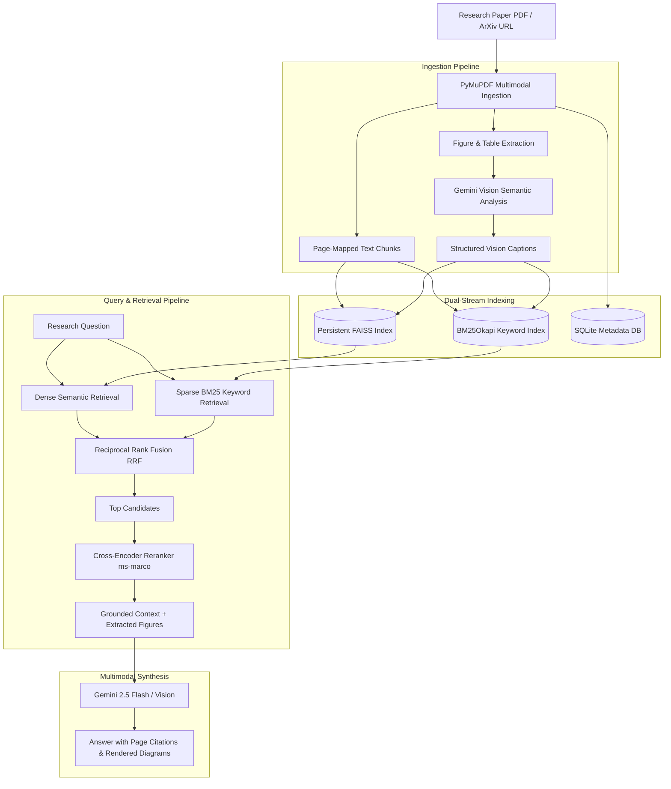

# Multimodal RAG Research Assistant
### *A Production-Grade, Multi-Document Literature Synthesis & Vision-Grounding System*

[](https://www.python.org/)
[](https://fastapi.tiangolo.com/)
[](https://react.dev/)
[](LICENSE)

An advanced multimodal Retrieval-Augmented Generation (RAG) system engineered for academic literature research. Unlike conventional text-only RAG pipelines, this system extracts, indexes, and reasons over **scientific figures, architecture diagrams, benchmark tables, and mathematical context** using a dual-stream hybrid retrieval pipeline combined with Gemini Vision.

Developed as a Final Year Computer Science Capstone Project.

---

## 🏛️ System Architecture



---

## 🔬 Mathematical Formulations

### 1. Hybrid Retrieval via Reciprocal Rank Fusion (RRF)
To balance semantic conceptual similarity (dense vectors) with exact academic terminology, author names, and mathematical symbols (sparse keywords), candidates are merged using **Reciprocal Rank Fusion (RRF)**:

$$RRF(d) = \sum_{m \in \{dense, sparse\}} w_m \cdot \frac{1}{k + r_m(d)}$$

Where:
- $r_{dense}(d)$ is the 1-based rank of passage $d$ from the FAISS inner-product search.
- $r_{sparse}(d)$ is the 1-based rank of passage $d$ from BM25Okapi scoring.
- $k = 60$ is the smoothing constant preventing high-ranked outliers from dominating.
- $w_{dense} = 0.6$ and $w_{sparse} = 0.4$ are the calibrated modal weights.

### 2. Neural Cross-Encoder Reranking
High-scoring candidate passages are re-scored using a joint cross-encoder (`cross-encoder/ms-marco-MiniLM-L-6-v2`):

$$s(q, d) = \sigma(W \cdot \text{BERT}([CLS] \circ q \circ [SEP] \circ d \circ [SEP]))$$

This computes full cross-attention across all tokens of query $q$ and document chunk $d$, filtering out spurious false-positive retrievals before generation.

### 3. Quantitative RAG Triad Evaluation
Evaluated along three academic dimensions:
- **Faithfulness (Hallucination Score):**
  $$\text{Faithfulness} = \frac{|\text{Grounded Statements in Answer}|}{|\text{Total Statements in Answer}|}$$
- **Answer Relevance:** Semantic alignment between generated response and input query.
- **Context Precision@K:** Ratio of retrieved passages that contain ground-truth reference material.

---

## ✨ Key Capabilities

| Feature | Description |
| :--- | :--- |
| **Multimodal Figure Extraction** | Automatically isolates diagrams, loss curves, and benchmark tables from PDFs; captions them with Gemini Vision; and renders the actual visual assets directly in chat responses. |
| **Persistent Multi-Document Corpus** | SQLite database and disk-persisted FAISS vector store retain documents across server restarts. Query single papers or search across the entire library. |
| **Hybrid Retrieval & Reranker** | Combines FAISS (`all-MiniLM-L6-v2`) and BM25Okapi with RRF score fusion, refined by an `ms-marco` cross-encoder. |
| **One-Click ArXiv Import** | Enter an arXiv ID or URL (e.g. `2312.00752`) to automatically download metadata, fetch the PDF, and trigger multimodal indexing. |
| **Interactive PDF Viewer & Citations** | Clickable `[Page X]` citations jump and synchronize the split-screen PDF viewer to the exact cited page. |
| **Cross-Paper Comparison Matrix** | Select 2+ papers to automatically generate a side-by-side comparative analysis of Problem, Methodology, Benchmarks, and Trade-offs. |
| **BibTeX & Literature Export** | Generate standard BibTeX citations with a single click. |
| **Built-in Benchmark Suite** | Automated evaluation script and UI testing panel to measure Faithfulness, Relevance, Precision, and Latency for your thesis defense. |

---

## 📁 Repository Structure

```
├── backend/
│   ├── main.py                  # FastAPI application entrypoint
│   ├── database.py              # SQLite persistence for documents & chunks
│   ├── requirements.txt         # Backend Python dependencies
│   ├── Dockerfile               # Backend container configuration
│   ├── services/
│   │   ├── pdf_processor.py     # Multimodal PDF extraction & diagram isolation
│   │   ├── gemini_service.py    # Gemini Vision & grounded synthesis service
│   │   ├── hybrid_search.py     # Persistent FAISS + BM25Okapi + RRF engine
│   │   ├── reranker.py          # Cross-Encoder neural reranking
│   │   ├── arxiv_service.py     # ArXiv paper downloader & metadata parser
│   │   └── synthesis_service.py # Paper comparison & BibTeX generation
│   ├── evaluation/
│   │   ├── benchmark.py         # RAG Triad evaluation metrics
│   │   └── run_ablation.py      # Automated CLI ablation study runner
│   └── uploads/                 # Uploaded PDFs and extracted figures
├── frontend/
│   ├── src/
│   │   ├── api.js               # Frontend API client
│   │   ├── App.jsx              # Main React application & state management
│   │   ├── pages/
│   │   │   ├── Library.jsx      # Research corpus, ArXiv import, Paper comparison
│   │   │   ├── Assistant.jsx    # Split-screen viewer, chat, inline figure preview
│   │   │   └── Settings.jsx     # Hyperparameter sliders, benchmark evaluation UI
│   │   └── components/          # Modular UI components & SVG icons
│   ├── Dockerfile               # Multi-stage production frontend Dockerfile
│   └── vite.config.js           # Vite development and proxy configuration
└── docker-compose.yml           # Unified orchestration for backend + frontend
```

---

## 🚀 Getting Started

### Prerequisites
- Python 3.11+
- Node.js 18+ & npm
- Google Gemini API Key ([Get one here](https://aistudio.google.com/))

### 1. Backend Setup
```bash
cd backend
python -m venv venv
source venv/bin/activate  # On Windows: venv\Scripts\activate
pip install -r requirements.txt

# Add your Gemini API Key
echo "GOOGLE_API_KEY=your_gemini_api_key_here" > .env

# Run FastAPI backend
uvicorn main:app --reload --port 8000
```
*API Swagger Documentation will be available at:* `http://127.0.0.1:8000/docs`

### 2. Frontend Setup
```bash
cd frontend
npm install
npm run dev
```
*Interactive Web Application will be available at:* `http://localhost:5173`

---

## 🐳 Running with Docker

You can launch the entire stack with a single command:
```bash
# Set your API key in environment
export GOOGLE_API_KEY=your_gemini_api_key_here

docker compose up --build
```
- Frontend: `http://localhost:5173`
- Backend API: `http://localhost:8000`

---

## 📊 Running the Evaluation Benchmark

For your Final Year Project thesis and presentation defense, you can generate quantitative ablation tables:

```bash
cd backend
python evaluation/run_ablation.py
```

This runs an automated benchmark comparing:
1. **Naive Dense RAG** (FAISS text-only baseline)
2. **Hybrid RAG** (FAISS + BM25Okapi)
3. **Multimodal RAG + Cross-Encoder** (Full pipeline with vision grounding)

It prints an ASCII comparison table and saves an `evaluation_report.md` report directly formatted for inclusion in your project report.

---

## 📝 License
This project is open-source under the [MIT License](LICENSE).
